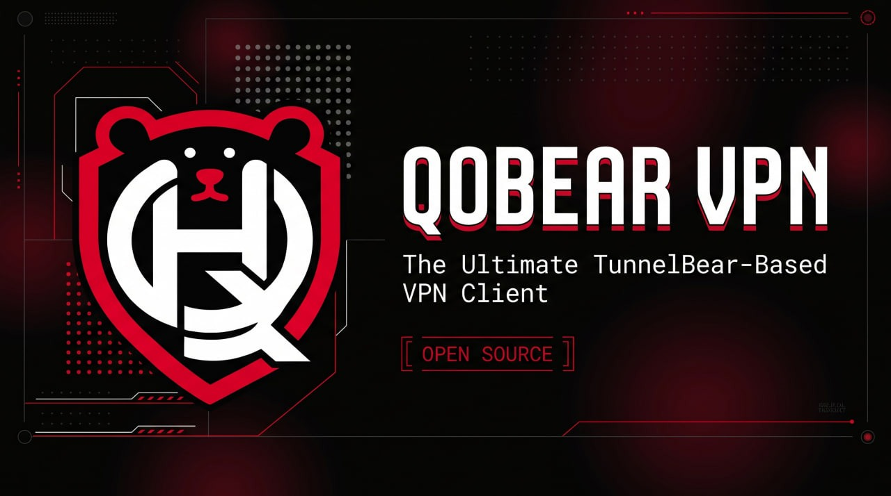

# QobearVPN

<p align="center">
  <strong>Android OpenVPN 3 client with native DPI bypass, regional split routing, TunnelBear support, and custom profile management</strong>
</p>

<p align="center">
  <a href="README.md">نسخه فارسی</a> ·
  <a href="https://t.me/Qorvhex_Channel">Telegram (@Qorvhex_Channel)</a> ·
  <a href="LICENSE">Apache 2.0 License</a>
</p>

---

> [!TIP]
> **Need a TunnelBear Account?**
> 📘 [TunnelBear 100GB/mo Account Guide](#)
> You can also skip TunnelBear sign-in during onboarding and import your own `.ovpn` or `.zip` custom profiles directly.

---

## Features

### 🚀 Native OpenVPN 3 Core & Anti-Censorship
- **Full OpenVPN 3 Engine (`libovpn3.so`)**: Native C++ core integrated with Android `VpnService` via JNI for responsive, low-overhead tunneling.
- **Split-Bypass Local TCP Relay (DPI Bypass)**: Optional client-side TCP segmentation and TLS ClientHello timing relay (`SplitBypassRelay`) designed to circumvent strict deep-packet inspection (configurable in Settings).
- **DNS & IPv6 Leak Protection**: Custom resolver selection (`Cloudflare`, `Quad9`, `AdGuard`, server-pushed DNS, or custom IPv4) and IPv6 capture while the VPN tunnel is active.

### 🌍 Server Discovery, Real TLS Probing & Custom Profiles
- **47 Pre-Bundled TunnelBear Profiles**: Pre-packaged profiles ready out of the box (`TCP 7011`, `AES-256-CBC`, `TLSv1.2+`).
- **Batch `.ovpn` & `.zip` Archive Import**: Import multiple `.ovpn` configs or bundled `.zip` archives with strict X.509 CA validation, weak cipher rejection (`none`, `rc4`, `des`, `bf`, `md5`/`sha1`), and companion certificate support.
- **Interactive Custom Profile Authentication**: Non-TunnelBear profiles requiring `auth-user-pass` prompt through a clean dialog with an optional **Save credentials** toggle stored securely in `AndroidKeyStore`.
- **Smart Filters & Management**: Filter servers by **All**, **Favorites**, **Reachable**, or **Custom**; delete imported custom profiles; run single-node one-tap pings from the Home screen; or batch-probe reachable latencies via real TLS handshakes.
- **Auto-Connect Best Server**: Automatically probes and selects the lowest-latency reachable server when needed.

### 🔀 Geo-Bypass & Per-App Split Tunneling
- **Regional Route Exclusions**: Direct domestic routing for **Iran (IR)**, **China (CN)**, and **Russia (RU)** (1,200 verified IPv4 CIDRs per region) alongside **100% Global Tunnel** mode.
- **Per-App Split Tunneling**: Supports `All Apps`, `Allow Only` (whitelist), and `Bypass Selected` (blacklist), including system app visibility toggle and one-tap **Save & Reconnect**.
- **Dedicated LAN Bypass**: Independent Settings toggle for local network subnet bypass.

### 🔐 Security, Persistence & UI
- **Hardware-Backed Vault (`AndroidKeyStore AES-256-GCM`)**: Encrypts TunnelBear accounts and saved custom server credentials (`QobearVault`). Strict isolation guarantees TunnelBear credentials are never sent to third-party servers.
- **Seamless Network-Switch Auto-Reconnect**: Automatically re-establishes the tunnel when switching between Wi-Fi and mobile data.
- **System Integration**: Android Quick Settings Tile (`QobearTileService`), in-app battery optimization exemption request, and real-time OpenVPN engine log viewer.
- **Bilingual Nothing OS-Inspired UI**: Full Dark/Light themes with Dot-Matrix & Space Mono display typography alongside English and RTL Persian (`Vazirmatn`).

---

## Quick Start

1. **Pick Routing Mode**: Choose a Geo-Bypass region (Iran, China, Russia, or Global) during onboarding.
2. **Sign In or Skip**: Enter a TunnelBear account, or tap **Skip & Enter** to jump straight into custom `.ovpn` servers.
3. **Connect & Monitor**: Tap the dial on the Home screen, verify live exit IP and bandwidth speeds, or re-ping the active node with a single tap.

---

## Building from Source

Native C++ dependencies (`OpenVPN 3`, `Asio`, `mbedTLS`, `LZ4`, `LZO`, `fmt`) are pinned in [`third_party/openvpn3/source-lock.json`](third_party/openvpn3/source-lock.json).

```bash
# 1. Fetch pinned native C++ dependencies
python scripts/fetch_openvpn_deps.py

# 2. Run JVM unit tests & build APKs
./gradlew testDebugUnitTest assembleDebug
./gradlew assembleRelease
```

GitHub Actions builds and signs three separate APK artifacts (`arm64-v8a`, `armeabi-v7a`, and `universal`) via `.pk8` / `.x509.pem` signing secrets (`QOBEAR_PK8_BASE64`, `QOBEAR_X509_BASE64`).

---

## Privacy & License

All credentials and routing profiles stay on-device encrypted under `AndroidKeyStore`. No telemetry or third-party tracking SDKs are included.

Licensed under the [Apache License 2.0](LICENSE).
Official Telegram Channel: [@Qorvhex_Channel](https://t.me/Qorvhex_Channel)
