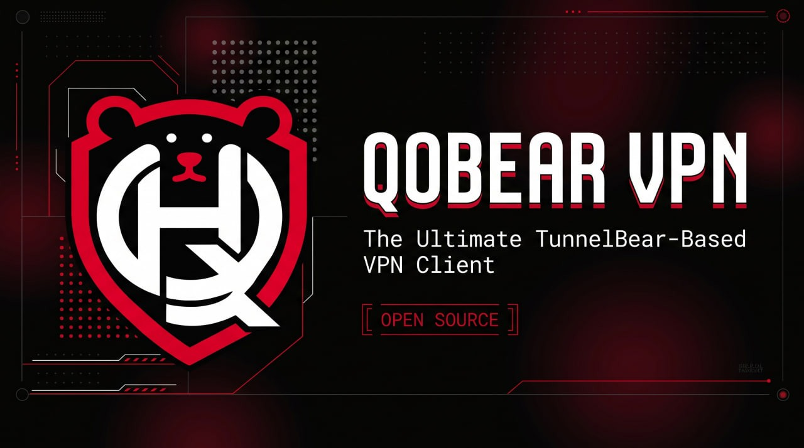

# QobearVPN

<p align="center">
  <strong>کلاینت اختصاصی OpenVPN 3 برای اندروید با هسته بومی ضدسانسور، مسیریابی هوشمند و پشتیبانی از TunnelBear و سرورهای شخصی</strong>
</p>

<p align="center">
  <a href="README.en.md">English README</a> ·
  <a href="https://t.me/Qorvhex_Channel">کانال تلگرام (@Qorvhex_Channel)</a> ·
  <a href="LICENSE">لایسنس Apache 2.0</a>
</p>

---

> [!TIP]
> **اکانت TunnelBear ندارید؟**
> 📘 [آموزش ساخت اکانت ۱۰۰ گیگ ماهانه تانل‌بر](#)
> همچنین می‌توانید بدون نیاز به اکانت TunnelBear وارد برنامه شوید و مستقیماً از پروفایل‌های `.ovpn` شخصی خود استفاده کنید.

---

## ویژگی‌ها و قابلیت‌ها

### 🚀 هسته بومی OpenVPN 3 و ضدسانسور
- **هسته کامل OpenVPN 3 (`libovpn3.so`)**: پیاده‌سازی بومی به زبان C++ با رابط JNI مستقیم به `VpnService` اندروید برای پایداری و سرعت بالا.
- **ضدسانسور قوی (DPI Bypass Relay)**: رله محلی مبتنی بر TCP با تکه‌تکه‌سازی بسته اولیه TLS و زمان‌بندی تصادفی (`SplitBypassRelay`) برای عبور از فیلترینگ‌های سنگین DPI (قابل فعال‌سازی از بخش تنظیمات).
- **جلوگیری از نشت DNS و IPv6**: هدایت امن DNS انتخابی (`Cloudflare`، `Quad9`، `AdGuard`، DNS سرور یا IPv4 دلخواه) و مسدودسازی نشت IPv6 هنگام فعال‌بودن VPN.

### 🌍 مدیریت سرورها، پینگ واقعی و پروفایل‌های شخصی
- **۴۷ سرور آماده TunnelBear**: به‌همراه فایل‌های رسمی آماده داخل برنامه (پورت `7011 TCP`، رمزنگاری `AES-256-CBC` و TLS 1.2+).
- **وارد کردن دسته‌ای `.ovpn` و فایل `.zip`**: پشتیبانی از انتخاب هم‌زمان چند پروفایل `.ovpn` یا آرشیو `.zip` شامل گواهی‌های همراه با اعتبارسنجی دقیق امنیتی X.509 و مسدودسازی الگوریتم‌های ناامن.
- **پاپ‌آپ هوشمند احراز هویت سرورهای شخصی**: برای کانفیگ‌های شخصی نیازمند نام کاربری و رمز عبور، پنجره ورود هنگام اتصال نمایش داده می‌شود و در صورت تمایل با تیک ذخیره رمز، در حافظه رمزنگاری‌شده نگهداری می‌شود.
- **فیلتر و مدیریت سرورها**: دسته‌بندی **همه**، **برگزیده‌ها**، **سالم‌ها** و **شخصی**، به‌همراه امکان حذف سرورهای شخصی، تست تکی با یک ضربه از صفحه اصلی و تست هم‌زمان تمام سرورها با هندشیک واقعی TLS.
- **اتصال خودکار به سریع‌ترین سرور**: آزمایش خودکار سرورها در صورت نامشخص‌بودن پینگ و انتخاب کم‌تأخیرترین نود سالم.

### 🔀 مسیریابی هوشمند (Geo-Bypass) و اسپلیت تانلینگ
- **بایپس کشوری دقیق**: عبور مستقیم آی‌پی‌های داخلی **ایران (IR)**، **چین (CN)** و **روسیه (RU)** (۱۲۰۰ رنج CIDR تاییدشده برای هر کشور) یا حالت **تونل کامل جهانی (Global)**.
- **اسپلیت تانلینگ پیشرفته اپلیکیشن‌ها**: حالت‌های `همه برنامه‌ها`، `فقط انتخابی‌ها` و `بایپس انتخابی‌ها` با جستجو، نمایش برنامه‌های سیستمی و دکمه ذخیره و اتصال مجدد آنی.
- **بایپس شبکه محلی (LAN)**: گزینه مجزا برای دسترسی مستقیم به تجهیزات شبکه داخلی و روتر.

### 🔐 امنیت، طراحی و پایداری
- **حافظه امن سخت‌افزاری (`AndroidKeyStore AES-256-GCM`)**: رمزنگاری تمام اکانت‌های TunnelBear و رمزهای ذخیره‌شده سرورهای شخصی؛ جداسازی کامل اعتبارنامه‌ها به‌طوری‌که اطلاعات TunnelBear هرگز به سرورهای شخص ثالث ارسال نمی‌شود.
- **اتصال مجدد خودکار هنگام تغییر شبکه**: سوئیچ روان هنگام جابه‌جایی بین Wi-Fi و اینترنت همراه.
- **تایل دسترسی سریع (Quick Settings Tile)**، وضعیت درخواست معافیت باتری مستقیم داخل تنظیمات، و گزارش زنده هسته (`Logs`).
- **رابط کاربری دوزبانه (فارسی راست‌به‌چپ با فونت Vazirmatn و انگلیسی)** با تم تاریک و روشن الهام‌گرفته از طراحی **Nothing OS**.

---

## راهنمای سریع استفاده

1. **شروع سریع**: در صفحه آغازین، منطقه بایپس مورد نظر (مثلاً ایران) را انتخاب کنید.
2. **ورود اطلاعات یا رد کردن**: می‌توانید حساب TunnelBear خود را وارد کنید یا بدون ورود حساب مستقیماً وارد برنامه شده و سرور `.ovpn` شخصی اضافه کنید.
3. **اتصال و پایش**: در صفحه اصلی روی دایره اتصال ضربه بزنید، سرعت لحظه‌ای و تاییدیه IP خروجی را مشاهده کنید و با یک لمس پینگ نود فعال را بسنجید.

---

## ساخت پروژه از سورس (Build)

وابستگی‌های بومی (`OpenVPN 3`، `Asio`، `mbedTLS`، `LZ4`، `LZO`، `fmt`) در فایل قفل [`third_party/openvpn3/source-lock.json`](third_party/openvpn3/source-lock.json) پین شده‌اند.

```bash
# ۱. دانلود کتابخانه‌های بومی پین‌شده
python scripts/fetch_openvpn_deps.py

# ۲. اجرای تست‌های واحد و ساخت نسخه دیباگ / ریلیز
./gradlew testDebugUnitTest assembleDebug
./gradlew assembleRelease
```

خروجی‌های امضاشده در GitHub Actions به‌صورت سه فایل مجزا (`arm64-v8a`، `armeabi-v7a` و `universal`) منتشر می‌شوند.

---

## حریم خصوصی و مجوز

تمامی اطلاعات حساب و کلیدها به‌صورت محلی روی دستگاه در `AndroidKeyStore` نگهداری می‌شوند و هیچ سرور واسط یا ردیاب تحلیلی در برنامه وجود ندارد.

این پروژه تحت مجوز [Apache License 2.0](LICENSE) منتشر شده است.
توسعه و انتشار رسمی: [@Qorvhex_Channel](https://t.me/Qorvhex_Channel)
